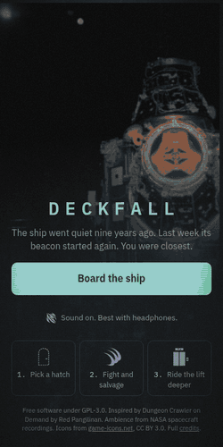

# Deckfall

A quick, text-first sci-fi dungeon crawler for the browser. You are a salvager
boarding a dead ship. Each deck offers a few hatches; you choose which to open,
fight what is behind it, strip the wreck for gear, and ride the lift down until
something kills you.

**Play it: https://tullycrow.github.io/deckfall/** (works on a phone, installs as an app, plays offline)

<p align="center"></p>

This is a build-in-public project: the game is playable from the first commit and
grows in the open. "Deckfall" is a working title.

## Roadmap

- [x] Seeded runs, route choice, augments, salvage tiers, deck guardians
- [x] Icons for every hostile, item and room
- [x] Phone-first layout, installable, offline, guided first run
- [ ] The tabletop layer: classes, ability scores and d20 checks on what you find
- [x] Sound and atmosphere: NASA recordings, heartbeat, whispers, film grain
- [x] Safe pods and crafting at the workbench
- [x] Suit camera: NASA photographs per room, animated silhouettes, static
- [ ] Dread as a mechanic: a second meter, and hatches whose labels you cannot fully trust
- [ ] Balance pass from real play data

## Tone

Deckfall is meant to be eerie more than gory: a psychological thriller in a
dead ship. The ambience is real spacecraft recordings from NASA, slowed down
(Saturn's radio emissions, wind on Mars, a rover's metal creaks). Between rooms
the log sometimes notes things that change nothing in the game and are there
only to make you doubt the ship. Deeper down, hatch labels flicker to words
that were not there a moment ago. When you are badly hurt you hear a heartbeat
and red closes in from the edges of the screen.

Above the log is your suit camera: a NASA photograph of a real spacecraft
interior for each kind of room, graded dark and run through scanlines and
static. Whatever is in the room appears in it as a black shape with light
leaking round its edge, breathing, and lunging when it hits you. On deeper
decks the picture is replaced, for a tenth of a second, by something else.

Every asset is free and credited in [public/CREDITS.md](public/CREDITS.md).

## What makes it different

- **You choose your route.** Every room is a pick between two or three hatches
  with a hint about what is behind each. Some panels are dead and tell you
  nothing.
- **Seeded runs.** A seed builds the same ship every time, so a run can be
  retried, shared or raced. There is a daily seed.
- **Augments, not stat points.** Each level offers three augments; pick one.
  An auto-surgeon will sell you another for a share of your health.
- **A safe pod between decks.** The lift always stops at a sealed pod: rest
  once, and use the workbench. Scrap and kills give parts; parts mix stims,
  overclock what you wear, re-roll it, or fuse three pieces into one of the
  next tier.
- **Fights play themselves, but you can step in.** Use a stim (it costs your
  place in the turn order), run, or let it resolve instantly.

## On a phone

- **Installable and offline.** It is a progressive web app: add it to the home
  screen and it opens full-screen and plays with no connection. A small
  hand-written service worker (`pwa/sw.template.js`, filled in by a build step
  in `vite.config.ts`) stores every file on first visit.
- **Laid out for thumbs.** The decision of the moment sits at the bottom of the
  screen, above a fixed bar with the pack, stims and menu. Nothing needs a
  scroll on a 375 x 667 screen except a full trader's stock.
- **A guided first five minutes.** A new player gets one button, a hand-picked
  first ship whose opening fight is winnable and drops a weapon (a test keeps
  that true), and one-time tips that appear only when their moment comes up.
  Low health pulses the health bar and turns the stim button red.

## Running it

```sh
npm install
npm run dev      # play locally
npm test         # engine tests
npm run build    # typecheck and build to dist/
npm run deploy   # test, build and publish dist/ to GitHub Pages
```

## How it is built

- **`src/engine/`** is the whole game as plain TypeScript with no browser or
  framework code. `reduce(state, action)` is a pure function: the same state
  and action always give the same result. The random number generator's state
  is part of the game state, which is what makes saves, replays and seeded
  runs work.
- **`src/engine/bot.ts`** is a simple automatic player. The tests use it to
  play hundreds of full runs and fail if a balance change makes the game
  trivial or impossible.
- **`src/ui/`** is a thin React layer that draws the current state and sends
  actions. The game saves to the browser's local storage after every action.

Stack: TypeScript, React, Vite, Vitest. No other runtime dependencies.

## Credits

Inspired by [Dungeon Crawler on Demand](https://github.com/redpangilinan/dungeon-crawler-rpg-od)
by Red Pangilinan. Deckfall is a new codebase and shares no code or assets
with it.

Sound, texture, type and icon credits are in [public/CREDITS.md](public/CREDITS.md).

Icons are from [game-icons.net](https://game-icons.net) by Lorc, Delapouite,
Skoll, Sbed, John Colburn and Lord Berandas, used under
[CC BY 3.0](https://creativecommons.org/licenses/by/3.0/) with their background
squares removed. The per-icon list is in
[public/icons/CREDITS.md](public/icons/CREDITS.md). To add or change icons,
edit the list in `scripts/build-icons.mjs` and run it against a clone of
[game-icons/icons](https://github.com/game-icons/icons).

## Licence

Code: GPL-3.0-only. See [LICENSE](LICENSE). Icons: CC BY 3.0. Audio and texture: public domain and CC0. Fonts: SIL OFL 1.1.
